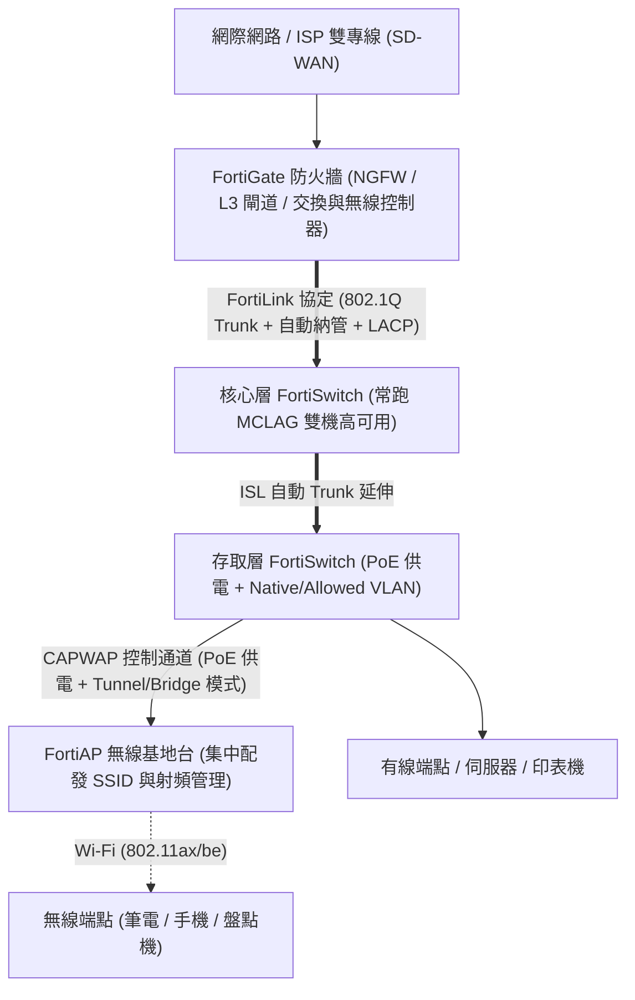
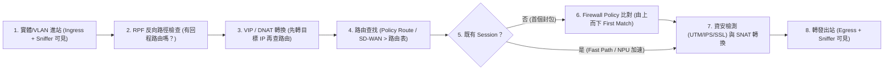
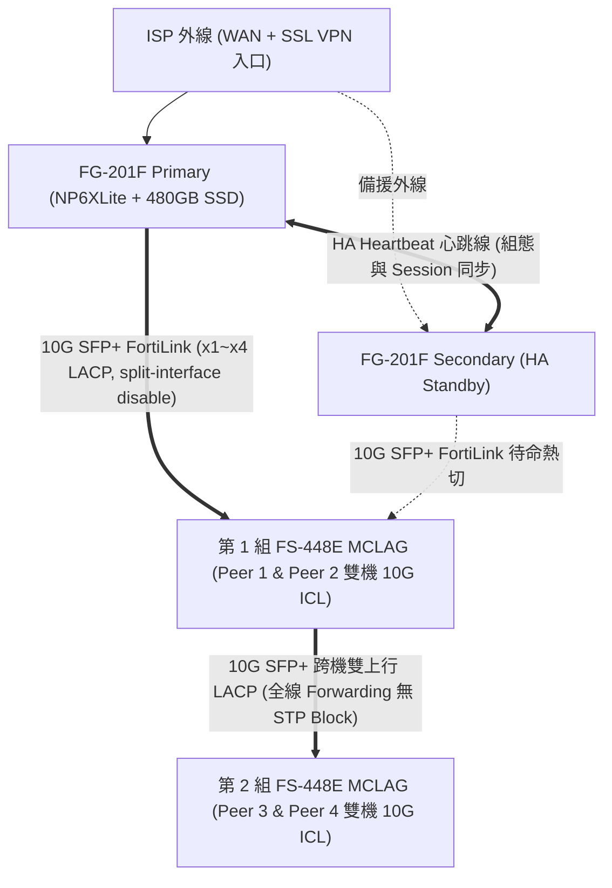

# 🛡️ Fortinet 鐵三角（Security Fabric）系統化觀念轉換與實戰查修指令全集（CCNA 背景無痛銜接版）

> **適用對象**：具備傳統網路基礎（如 Cisco CCNA 路由交換觀念：VLAN / 802.1Q Trunk / STP / LACP / Static & OSPF / ACL / NAT），現負責維運企業 **Fortinet 鐵三角（FortiGate + FortiSwitch + FortiAP）** 架構之資訊與網管人員。

---

## 🧭 一、 核心觀念轉換：從 Cisco IOS（CCNA）到 Fortinet 鐵三角

在民國 101 年（Cisco IOS 12.4 / 15.0 時代）的 CCNA 架構中，Router、Switch、Wireless Controller 各司其職且各自獨立管理；而在 **Fortinet 鐵三角（Fortinet Security Fabric）** 架構中，**FortiGate 就是整座網路的大腦（Core Router + NGFW + Switch Controller + Wireless Controller）**。

### 1. 鐵三角角色與控制協定架構圖



### 2. CCNA 工程師最需要先建立的 6 大觀念差異

| 觀念維度 | Cisco CCNA 傳統思維 | Fortinet 鐵三角（FortiOS）核心邏輯 | 實務踩坑提醒 |
| :--- | :--- | :--- | :--- |
| **1. 設定存檔時機** | 修改後在 `running-config` 立即生效，但沒敲 `wr` / `copy run start` 重開機就會還原 | 採用 `config` → `edit` → `set` 階層樹狀結構；**敲下 `next` 或 `end` 的瞬間即生效並寫入 NVRAM 存檔！** | 敲錯想放棄修改必須輸入 **`abort`**（不要習慣性敲 `end`） |
| **2. VLAN 與閘道位置** | 每台 Switch 都要進 CLI 建 `vlan 10`，Core Switch 建 `interface Vlan10` (SVI) | **所有 VLAN 直接建在 FortiGate 的 `FortiLink` 介面下**，每建一個 VLAN 自動就是 L3 SVI 閘道，並自動同步派送到所有 FortiSwitch | **千萬不要**自己 SSH 進納管後的 FortiSwitch 手動改 VLAN，會被控制器覆蓋或衝突 |
| **3. Trunk 與 Access** | `switchport mode access` / `switchport mode trunk` + `allowed vlan` | FortiSwitch Port 沒有分死 Access/Trunk 模式，統一由兩個欄位決定：<br/>• **Native VLAN** = 不帶 Tag 的 VLAN（等同 Access VLAN）<br/>• **Allowed VLANs** = 允許帶 802.1Q Tag 通過的 VLAN 清單 | 一般電腦只需設 `Native VLAN`；接 **Bridge 模式 AP** 或 **IP Phone** 則需同時設 `Native VLAN` + `Allowed VLANs` |
| **4. 預設轉發行為** | Router 只要有路由且沒綁 ACL，預設跨網段全通 | **Stateful Firewall 預設全擋（Implicit Deny / Policy 0）**！即使兩個 VLAN 直連在 FortiGate 上，沒寫 `Firewall Policy` 一律不通 | 連 Ping FortiGate 自己的 Gateway IP，都必須在該介面 `Administrative Access (allowaccess)` 勾選 `PING` |
| **5. NAT 實作方式** | 介面標記 `ip nat inside/outside` + ACL + `overload` 或 `static` | • **上網 SNAT (PAT)**：直接在 Firewall Policy 把 `NAT` 開關打開即可<br/>• **對外映射 DNAT**：先建立 **VIP (Virtual IP)** 物件，**且必須把該 VIP 放進 Policy 的 `Destination` 欄位才會生效！** | 只建好 VIP 卻在 Policy 的 Destination 放真實內網 IP，外網永遠連不進來 |
| **6. 反向路徑檢查 (RPF)** | 預設不開 `ip verify unicast source reachable-via rx`，允許非對稱路由 | **預設強制啟用 RPF（Anti-Spoofing）**！封包從介面 A 進來，FortiGate 會查「回程往該來源 IP 的最佳路由是不是也走介面 A」，不是就直接丟棄（Drop） | 雙專線（WAN1/WAN2）或內網另有 L3 交換器時，最常因 RPF 導致單向不通 |

---

### 3. FortiOS CLI 四大基礎動詞與過濾神技

剛從 Cisco 轉過來時，請先記住 FortiOS CLI 的四個開頭動詞：

1. **`get <階層>`**：查看**目前運作中的動態狀態或完整參數值**（含系統預設值）。
2. **`show <階層>`**：查看**組態設定檔**（類似 Cisco `show run`，預設**只顯示有修改過的非預設值**；若要看包含預設值的全部設定，用 `show full-configuration`）。
3. **`execute <動作>`（簡寫 `exec`）**：執行動作指令（如 `exec ping`、`exec traceroute`、`exec ssh`、`exec reboot`）。*(注意：直接打 `ping` 會報錯，前面一定要加 `exec`！)*
4. **`diagnose <模組>`（簡寫 `diag`）**：底層除錯、硬體狀態、Session 表、封包擷取（Sniffer）與封包流程追蹤（Debug Flow）。

> [!TIP]
> **媲美 Cisco `show run | section` 的必學神技：`| grep -f`**
> 在 FortiOS 任何 `show` 或 `get` 指令後加上 `| grep -f <關鍵字>`（注意那個 **`-f`**），系統不只會標出那一行，還會**把該行所屬的整個 `config ... edit ... next ... end` 上下文區塊完整印出來**！
> ```bash
> # 範例：找出整個設定檔中哪裡有用到 192.168.10.50，並顯示完整設定區塊
> show | grep -f 192.168.10.50
> ```

---

### 4. 鐵三角封包處理流程（查修定位地圖）

當使用者報修「網路不通」時，請對照以下 FortiGate 內部處理順序判斷卡在哪一關：



> [!IMPORTANT]
> **VIP (DNAT) 與路由/Policy 的先後順序**：外網連進 VIP 時，FortiGate 會**先將目標公網 IP 轉成內網真實 IP（DNAT）**，接著才查往內網的路由與比對 Policy（但 Policy 的 Destination 仍必須選該 VIP 物件）。

---

## 🔄 二、 Cisco IOS 與 FortiOS 常用查修指令對照速查表

| 查修目的 | Cisco IOS 指令（CCNA 記憶） | FortiOS 對應指令（在 FortiGate 執行） |
| :--- | :--- | :--- |
| **查看系統版本、序號、資源** | `show version`<br/>`show processes cpu` | `get system status`<br/>`get system performance status` |
| **查看實體埠 Link/Speed 狀態** | `show interfaces status` | `get system interface physical` |
| **查看所有介面 IP 清單** | `show ip interface brief` | `diagnose ip address list`<br/>或 `get system interface` |
| **查看特定介面組態 / 收發錯包** | `show run interface gi0/1`<br/>`show interfaces gi0/1` | `show system interface port1`<br/>`diagnose hardware deviceinfo nic port1` |
| **查看 LACP (EtherChannel) 狀態** | `show etherchannel summary` | `diagnose netlink aggregate list`<br/>`diagnose netlink aggregate name <名稱>` |
| **查看 ARP 表 (IP 對 MAC)** | `show ip arp` | `get system arp`（可搭 `\| grep <IP>`） |
| **查看生效中的路由表 (RIB)** | `show ip route` | `get router info routing-table all` |
| **查某 IP 走哪條路由 (最精準)** | `show ip route 10.1.2.3` | `get router info routing-table details 10.1.2.3` |
| **查看所有備援/未生效路由** | `show ip route` / `show ip ospf database` | `get router info routing-table database` |
| **查看 Policy Route / SD-WAN** | `show ip policy` | `diagnose firewall proute list` |
| **查看 DHCP 租約派發清單** | `show ip dhcp binding` | `execute dhcp lease-list` |
| **指定來源 IP 進行 Ping** | `ping 8.8.8.8 source 192.168.1.1` | **分兩行下**：<br/>`exec ping-options source 192.168.1.1`<br/>`exec ping 8.8.8.8` |
| **查看交換器 MAC Address 表** | `show mac address-table` | `diagnose switch-controller switch-info mac-table` |
| **查看 NAT 連線轉換表** | `show ip nat translations` | `diagnose sys session filter ...`<br/>`diagnose sys session list` |

---

## 🔥 三、 FortiGate（第一角：核心大腦）四大查修神器

遇到跨網段不通、上網不通、VPN 不通或對外服務連不上時，依序使用以下四個工具，**100% 能找出封包死在哪裡**。

### 神器 1：進階 Ping 與 Traceroute（兩段式設定）
FortiGate 預設會拿「離目標最近的出站介面 IP」當來源去 Ping，測試內網或 VPN 時常因來源 IP 不對而誤判，務必先用 `ping-options` 指定來源：

```bash
# 1. 查看目前已經設定的 ping 參數
execute ping-options view-settings

# 2. 指定來源 IP（例如模擬某個 VLAN 的 Gateway 去 Ping）、封包大小、次數
execute ping-options source 192.168.10.254
execute ping-options repeat-count 5
execute ping-options data-size 1472
execute ping-options df-bit yes        # 測試 MTU 不分片（查 VPN / PPPoE 黑洞超好用！）

# 3. 執行 Ping
execute ping 8.8.8.8

# 4. 測完養成習慣重置參數
execute ping-options reset

# Traceroute 同理（指定來源介面或 IP）
execute traceroute-options source 192.168.10.254
execute traceroute 8.8.8.8
```

---

### 神器 2：路由全視角檢查（一般路由 vs 資料庫路由 vs 策略路由）
很多時候 `routing-table all` 看起來沒問題，但流量其實被 **SD-WAN / Policy Route** 優先攔走，或是雙線備援路由 AD 值設錯：

```bash
# 1. 查看目前「生效中（Active）」的路由表（代碼同 Cisco：C=直連, S=靜態, O=OSPF, B=BGP, *=預設）
get router info routing-table all

# 2. 查看「路由資料庫」（包含 AD 值較高而隱藏待命的備援靜態路由！查雙 WAN 備援必看）
get router info routing-table database

# 3. 查詢特定目標 IP 最終命中的路由明細
get router info routing-table details 172.16.50.10

# 4. 【關鍵！】檢查是否有 Policy Route 或 SD-WAN 規則優先攔截（優先權高於一般路由表！）
diagnose firewall proute list

# 5. 若有啟用 SD-WAN，檢查健康檢查 SLA（Health-Check）各線路延遲與掉包率
diagnose sys sdwan health-check
diagnose sys sdwan service4
```

---

### 神器 3：內建 Wireshark 即時抓包（`diagnose sniffer packet`）
不用在交換器設 Mirror Port 接筆電，FortiGate 內建 tcpdump 等級抓包工具！

**標準語法**：`diagnose sniffer packet <介面或any> '<過濾條件>' <顯示等級 1~6> <抓幾筆(0為無限)> <時間格式 l 或 a>`

```bash
# 【實戰最推薦範本】在所有介面 (any) 抓取與 192.168.10.50 相關的 ICMP 封包，等級 4（印出進出介面名），顯示本地時間 (l)
diagnose sniffer packet any 'host 192.168.10.50 and icmp' 4 0 l

# 抓取特定主機連往 443 Port 的 TCP 封包（查網頁或 API 不通）
diagnose sniffer packet any 'host 192.168.10.50 and tcp port 443' 4 50 l

# 抓取 DHCP 廣播過程（查電腦或 AP 拿不到 IP）
diagnose sniffer packet any 'port 67 or port 68' 4 0 l
```
*(按 `Ctrl + C` 停止抓包)*

**為什麼顯示等級永遠首推 `4`？**
- `4` 會清楚印出 `vlan10 in 192.168.10.50 -> 8.8.8.8` 與 `wan1 out <公網IP> -> 8.8.8.8`。
- **一眼秒判責任歸屬**：
  1. **連 `in` 都沒看到** 👉 問題在前端（電腦網卡、交換器 VLAN、AP 或實體線材），還沒到防火牆。
  2. **有看到 `in`，但沒有 `out`** 👉 被 FortiGate 自己攔掉了（Policy 擋掉、RPF 丟棄、或沒路由），立刻接著用下面的**神器 4（Debug Flow）**看死因！
  3. **有 `in` 也有 `out`，但沒有回程封包** 👉 封包已送出 FortiGate，問題在對端伺服器沒回、對端防火牆擋掉、或回程路由指錯。
- *(補充：若需匯出給電腦版 Wireshark 深度解析，將等級改為 `6`，把畫面 log 存檔後用 Fortinet `fgt2eth.pl` 或 Wireshark 直接匯入 Hex 即可。)*

> [!NOTE]
> **為什麼 TCP 前幾個封包看得到，後面傳資料卻抓不到？**
> 這是因為 FortiGate 具備硬體 ASIC（NP6 / NP7 / NP6XLite）**NPU Offload 硬體加速**！當 TCP 三向交握建立後，後續流量直接由硬體晶片轉發，不經過 CPU，因此 Sniffer 只會看到交握與結束封包，屬於正常現象。

---

### 神器 4：終極破案王牌 — Debug Flow（`diagnose debug flow`）
當 Sniffer 看到「有進沒出」時，不用在一百多條 Firewall Policy 裡肉眼大海撈針，直接跑 Debug Flow，FortiOS 會逐行告訴你這個封包查了哪條路由、做了什麼 NAT、最後被哪個 Policy ID 放行或拒絕！

> [!WARNING]
> 正式環境執行 Debug Flow **務必先下 `filter` 縮小範圍並限制追蹤封包數量（如 `50` 筆）**，測試完畢務必關閉 Debug，避免大量 Console 輸出拖慢系統效能。

```bash
# 步驟 1：清空舊的除錯設定與過濾器（養成好習慣）
diagnose debug reset

# 步驟 2：設定精準過濾條件（避免畫面被全公司流量洗版）
diagnose debug flow filter addr 192.168.10.50
diagnose debug flow filter port 443          # (選填) 再鎖定特定 Port，例如 443；若測 ping 可設 proto 1

# 步驟 3：開啟顯示函式名稱、Policy 比對細節與時間戳記
diagnose debug flow show function-name enable
diagnose debug flow show iprope enable
diagnose debug console timestamp enable

# 步驟 4：設定只抓取 50 個封包後自動停止，並正式啟動輸出
diagnose debug flow trace start 50
diagnose debug enable

# ========= 此時請使用者重現一次連線動作 =========

# 步驟 5：【測完必做】關閉除錯並重置
diagnose debug disable
diagnose debug reset
```

**Debug Flow 常見死因關鍵字判讀表**：
| 畫面出現的關鍵訊息 | 代表意義與解決方向 |
| :--- | :--- |
| `Denied by forward policy check (policy 0)` | **沒命中任何放行規則，落入最底層預設阻擋（Implicit Deny）** 👉 檢查 Firewall Policy 的來源/目的介面、IP 與 Service |
| `Denied by forward policy check (policy 25)` | 被編號 ID 為 `25` 的 Deny Policy 明確阻擋 👉 `show firewall policy 25` 查看該規則 |
| `reverse path check fail, drop` | **RPF 反向路徑檢查失敗被丟棄！** 👉 封包進站介面沒有通往該來源 IP 的回程路由（常見於漏建內網靜態路由或雙 WAN 非對稱路由） |
| `Allowed by Policy-12: SNAT` | 成功由 Policy ID 12 放行並執行來源 NAT |
| `VIP-<IP>:<Port>, matched` | 成功命中 VIP 進行 DNAT 目標轉換 |
| `find a route: flag=... gw-<IP> via <介面>` | 路由查找結果：將從 `<介面>` 丟給下一跳 `<IP>` |

---

### 附錄神器：Stateful Session 表查詢與「精準清除」
因為 FortiGate 是狀態檢測防火牆（Stateful Firewall），**當你修改了路由、NAT 或新增阻擋 Policy 時，已經建立中的舊連線（特別是 UDP：如 VoIP SIP、遊戲、長連線或持續 Ping）可能會繼續沿用舊的快取路徑（Dirty Session）而不生效！** 此時需清除該連線的 Session。

> [!CAUTION]
> **高風險指令警告！**
> 執行 `diagnose sys session clear` 前，**絕對、務必**先用 `diagnose sys session filter` 設定過濾條件並檢查！若在沒有任何 Filter 的狀態下直接敲 `diagnose sys session clear`，**會瞬間清空整台防火牆所有連線，導致全公司網路與 VPN 瞬間斷線重連！**

```bash
# 1. 先清除舊的過濾條件
diagnose sys session filter clear

# 2. 設定你要查詢或踢除的對象（例如來源 IP 192.168.10.50、目標 Port 5060）
diagnose sys session filter src 192.168.10.50
diagnose sys session filter dport 5060

# 3. 【安全確認】先查看過濾條件是否正確設定！（絕對不可省略！）
diagnose sys session filter

# 4. 列出命中的 Session 詳細內容（可看到 policy_id、NAT 轉換前後 IP、npu 硬體加速狀態）
diagnose sys session list

# 5. 確認無誤後，僅清除符合上述 Filter 的 Session
diagnose sys session clear

# 6. 結束後清空 Filter
diagnose sys session filter clear
```

---

## 🔌 四、 FortiSwitch（第二角：交換層與 FortiLink）查修指令集

在鐵三角架構中，**90% 以上的交換器查修都不需要一台一台登入 Switch**，直接在 **FortiGate CLI** 上就能查完所有交換器的連線、MAC 表、PoE 供電與線路狀態！

### 1. 在 FortiGate 上集中查修 FortiSwitch（日常最常用）

```bash
# 1. 【第一時間必跑】查看所有納管 FortiSwitch 的連線狀態、序號 (S/N)、內部 IP 與韌體版本
execute switch-controller get-conn-status
# -> 正常應顯示 Authorized / Up；若顯示 Down，立刻跑下一行自動診斷！

# 2. 【離線排錯神器】自動檢測特定 FortiSwitch 的 FortiLink 介面、DHCP、NTP 與控制通道哪裡異常
execute switch-controller diagnose-connection <Switch序號或名稱>

# 3. 以樹狀圖顯示 FortiGate 與各台 FortiSwitch 之間的實體接線拓樸（哪個 Port 接哪台）
execute switch-controller get-physical-conn standard

# 4. 【網管尋人神器】已知某台設備的 IP（例如 192.168.10.88），找出它插在哪台 Switch 的第幾埠！
#    Step A: 先在 FortiGate 查 ARP 取得該 IP 的 MAC Address
get system arp | grep 192.168.10.88
#    Step B: 在全網 FortiSwitch MAC 表搜尋該 MAC（瞬間顯示 Switch 序號、Port 號與 VLAN！）
diagnose switch-controller switch-info mac-table | grep -i <剛剛查到的MAC前幾碼>

# 5. 檢查各台 FortiSwitch 的 PoE 供電瓦數與各埠供電狀態（查 AP、監視器或話機不過電）
diagnose switch-controller switch-info poe

# 6. 檢查交換器之間的 Trunk (ISL) 與 MCLAG（雙核心交換器堆疊高可用）運作狀態
diagnose switch-controller switch-info trunk
diagnose switch-controller switch-info mclag

# 7. 檢查交換器各 Port 是否有大量 CRC 錯包、碰撞或掉包（查網路線水晶頭接觸不良）
diagnose switch-controller switch-info port-stats

# 8. 遠端重啟某一台卡住的 FortiSwitch
execute switch-controller switch-action reboot switch <Switch序號>
```

### 2. 跳板進入特定 FortiSwitch 本機 CLI 進階檢測（含實體測線儀！）
當需要檢查單台 Switch 底層資訊，或懷疑牆壁網路線斷芯時，可從 FortiGate GUI 點選 **Open FortiSwitch CLI**，或從 FortiGate SSH 跳過去（先由 `get-conn-status` 查出該 Switch 的 `169.254.1.x` FortiLink IP）：

```bash
# 在 FortiGate 上跳板 SSH 進入該台 FortiSwitch
execute ssh admin@169.254.1.5

# ====== 以下為進入 FortiSwitch 本機 CLI 後的指令 ======

# 1. 查看所有實體埠狀態、速率、雙工與收發狀態總覽
diagnose switch physical-ports summary

# 2. 查看各埠目前實際套用的 Native VLAN 與 Allowed VLANs
get switch interface

# 3. 查看 STP (MSTP) 各埠轉發/阻擋狀態（排查迴圈 Loop 或 Port 被 Edge Port / Loop Guard 鎖住）
diagnose stp instance list

# 4. 查看交換器本機的 LACP Trunk 與 MCLAG ICL 通道健康度
diagnose switch trunk summary
diagnose switch mclag icl

# 5. 【現場查線超實用】內建 TDR 實體網路線診斷（免帶測線器，直接量測網路線第幾對芯斷在幾公尺處！※執行時該埠會瞬斷 1~2 秒）
diagnose switch physical-ports cable-diag <port名稱，如 port5>
```

---

## 📡 五、 FortiAP（第三角：無線網路與 CAPWAP）查修指令集

FortiAP 透過 **CAPWAP**（Control And Provisioning of Wireless Access Points，UDP `5246` 控制通道 / `5247` 資料通道）受 FortiGate 內建的 Wireless Controller 集中控管，架構概念與 Cisco WLC + Lightweight AP 高度一致。

### 1. 先搞懂 Tunnel Mode 與 Bridge Mode 的查修差異

| SSID 模式 | 運作方式（對照 Cisco） | 閘道與 DHCP 在哪？ | 最常見故障盲點 |
| :--- | :--- | :--- | :--- |
| **Tunnel Mode**<br/>（集中轉發） | 無線流量經 CAPWAP 隧道包回 FortiGate，SSID 在 FortiGate 上就是一張獨立虛擬網卡 | 直接建在 FortiGate 的該 **SSID 介面**上 | 忘記寫「`SSID 介面` → `WAN / 內網 VLAN`」的 Firewall Policy |
| **Bridge Mode**<br/>（本地橋接） | AP 直接把無線封包打上 VLAN Tag（或不打 Tag）丟進連接該 AP 的 Switch Port | 建在對應的有線 **FortiLink VLAN** 上 | **接 AP 的那個 FortiSwitch Port 忘記把無線 VLAN 加進 `Allowed VLANs`**，導致 Wi-Fi 連得上卻永遠拿不到 IP（`169.254.x.x`）！ |

---

### 2. 在 FortiGate 上集中查修 FortiAP 與無線客戶端

```bash
# 1. 查看所有納管 FortiAP 清單與簡要狀態（上線時間、IP、連線人數、WTP ID）
diagnose wireless-controller wlac -c wtp

# 2. 查看更詳細的 FortiAP 狀態（含 Radio 1/2/3 頻道、發射功率、韌體版本）
diagnose wireless-controller wlac -d wtp

# 3. 查看所有已派發的 SSID (VAP) 狀態
diagnose wireless-controller wlac -c vap

# 4. 查看目前全公司所有無線連線裝置清單（MAC、IP、連哪顆 AP、SSID、RSSI 訊號強度、速率）
diagnose wireless-controller wlac -d sta

# 5. 【無線單機排錯王牌】針對某一台連不上 Wi-Fi 或一直斷線的筆電/盤點機 MAC 進行即時除錯
#    （可清楚看到 802.11 關聯、WPA2/WPA3 四向交握密碼錯、還是 RADIUS 802.1X 驗證失敗！）
diagnose wireless-controller wlac sta_filter aa:bb:cc:dd:ee:ff 2
diagnose debug console timestamp enable
diagnose debug enable

#    ---> 測完關閉無線單機除錯：
diagnose wireless-controller wlac sta_filter 00:00:00:00:00:00 0
diagnose debug disable
diagnose debug reset

# 6. 強制踢掉某台「黏住遠處微弱訊號 AP 不肯漫遊（Sticky Client）」的無線設備，讓它重連最近的 AP
diagnose wireless-controller wlac sta_del aa:bb:cc:dd:ee:ff

# 7. 遠端重啟單一顆 FortiAP（不影響其他 AP）
execute wireless-controller reset-wtp <AP序號或名稱>
```

> [!WARNING]
> 切勿隨意執行 `execute wireless-controller restart-acd`，該指令會重啟整台 FortiGate 的無線控制背景程式（`cw_acd`），導致全公司所有 AP 短暫重新註冊閃斷。單顆 AP 異常請用 `reset-wtp`。

---

### 3. 當 FortiAP 離線（Offline）無法納管時的本機 CLI 急救指令
若新買或重置後的 FortiAP 插上網路卻沒出現在 FortiGate，通常是：
1. 接 AP 的管理 VLAN 介面在 FortiGate 上**沒勾選 `Security Fabric Connection`（舊版稱 `CAPWAP`，CLI 為 `set allowaccess fabric`）**。
2. AP 與 FortiGate 跨不同網段，且 DHCP Server 沒派發 **Option 138**（告知 AP 控制器 IP 在哪）。
3. **系統時間（NTP）落差過大**導致 DTLS 憑證驗證失敗。
4. **PoE 供電規格不足**（例如 Wi-Fi 6E / Wi-Fi 7 高階 AP 需要 `802.3at (PoE+)` 或 `802.3bt (PoE++)`，交換器卻只給 `802.3af`，導致 AP 不斷重啟或關閉射頻）。

此時可 SSH 進入 FortiAP 的 IP（預設帳號 `admin`，密碼空白或由 FGT 派發）執行：

```bash
# ====== 以下為進入 FortiAP 本機 CLI 後的指令 ======

# 1. 查看 AP 目前的系統與控制器探索設定
cfg -s

# 2. 手動指定 FortiGate（控制器）的 IP 位址並儲存套用（跨網段救急最有效！）
cfg -a AC_IPADDR_1=192.168.1.254
cfg -c

# 3. 查看 AP 與 FortiGate 的 CAPWAP 狀態與錯誤原因
cw_diag -c wtp-cfg
```

---

## 🏢 六、 企業進階維運必備：HA 高可用叢集與 IPsec VPN 快篩

### 1. FortiGate HA 雙機叢集（Active-Passive）健康檢查
企業機房幾乎都是兩台 FortiGate 做 HA，維運與韌體升級前必跑以下三行：

```bash
# 1. 查看 HA 狀態、哪台是 Primary (Master) / Secondary (Slave)、Uptime 與 Heartbeat 介面狀態
get system ha status

# 2. 【極重要】比對兩台主備機的設定檔 Checksum 是否 100% 同步一致！
diagnose sys ha checksum cluster
# -> 觀察兩台設備的 `all: <16進位碼>` 每一行數值必須完全一模一樣！

# 3. 若發現主備不同步（Out-of-Sync），可先重算 Checksum 觸發重新同步：
diagnose sys ha checksum recalculate

# 4. 如何在 FortiGate Primary 上直接透過 HA 心跳線連進 Secondary 備機 CLI 檢查？
execute ha manage <備機編號，通常輸入 ? 可按 Tab 查詢，多為 0 或 1> <管理員帳號>
```

### 2. 外點 / 雲端 IPsec Site-to-Site VPN 查修（對照 Cisco `show crypto`）

```bash
# 1. 檢查 Phase 1 (IKE SA) 協商狀態（對應 Cisco `show crypto isakmp sa`）
#    -> 看 status 是否為 `established`；若卡在 `connecting`，多為兩端公網 IP、Pre-shared Key、IKEv1/v2 或加密演算法不一致
diagnose vpn ike gateway list

# 2. 檢查 Phase 2 (IPsec Tunnel SA) 狀態與封包進出計數器（對應 Cisco `show crypto ipsec sa`）
#    -> 重點看 `dec`（解密收包）與 `pkts/bytes`（加密送包）數字有沒有在跳動！
#    -> 若只有送包增加、收包為 0，代表對端路由沒指回來或對端防火牆擋掉
diagnose vpn tunnel list name <VPN隧道名稱>

# 3. 手動強制拉起（Bring Up）或重置某條卡住的 VPN 隧道
diagnose vpn tunnel up <Phase2名稱>
diagnose vpn ike gateway flush name <Phase1名稱>
```

---

## 🛠️ 七、 企業實戰 5 大常見報修情境 SOP（Troubleshooting Playbook）

### 情境 1：「新接一台電腦 / 印表機到牆壁資訊座，拿不到 IP（169.254.x.x）或燈號不亮」
1. **確認實體層與哪個 Port**：若燈不亮，檢查配線架對應之 FortiSwitch Port 是否開啟，或跑 `diagnose switch physical-ports cable-diag <port>` 測牆壁線路是否斷芯。
2. **確認 MAC 有沒有進來**：`diagnose switch-controller switch-info mac-table | grep -i <設備MAC>`，確認插在正確的 Switch 與 Port。
3. **檢查該 Port 的 Native VLAN**：在 FortiGate `WiFi & Switch Controller > FortiSwitch Ports` 確認該 Port 的 **Native VLAN** 是否設為正確部門 VLAN（而非預設隔離的 `onboarding` 或 `quarantine` VLAN！**※新裝 Switch 最常忘記改掉預設 `onboarding` VLAN**）。
4. **檢查 DHCP Server**：確認該 VLAN 介面已啟用 DHCP Server 且 IP Pool 未滿（`execute dhcp lease-list`），或用 `diagnose sniffer packet <vlan介面> 'port 67 or port 68' 4 0 l` 看有沒有收到 DHCP Discover。

---

### 情境 2：「電腦可以正常上網，但 Ping 不到隔壁網段的 NAS / ERP 主機」
1. **Ping 自己的 Gateway**：從電腦 Ping 自己的 VLAN Gateway（若不通但能上網，只是該 VLAN 介面沒開 `allowaccess ping`）。
2. **在 FortiGate 跑 Sniffer（等級 4）**：
   ```bash
   diagnose sniffer packet any 'host <電腦IP> and host <ERP_IP>' 4 0 l
   ```
   - 若看到 `vlan_user in` 卻**沒有** `vlan_erp out` 👉 跑 **Debug Flow**，九成是漏開跨 VLAN 的 Firewall Policy，或是該電腦中了 **Policy Route / SD-WAN 規則**，導致連內網 `192.168.x.x` 也被強制往外網 WAN 丟！（**解法**：在 SD-WAN Rules 最上方加一條目標為內網 RFC1918 私有網段不走 SD-WAN 的規則，或補齊正確路由）。
   - 若看到 `vlan_user in` 且有 `vlan_erp out`，但沒回包 👉 **ERP 主機本身的 Windows 防火牆擋掉跨網段連線**，或 ERP 主機的 Default Gateway 沒指向 FortiGate！

---

### 情境 3：「設定好了 VIP（Port Forwarding），但從外網連不進公司內部主機」
依序檢查以下 **VIP 四大鐵律**：
1. **Sniffer 確認外網封包有沒有到 WAN 口**：`diagnose sniffer packet any 'port <對外Port>' 4 0 l`。若連 `wan1 in` 都沒有，代表前端中華電信數據機沒做 Bridge、ISP 封鎖該 Port、或 DNS 指錯公網 IP。
2. **Policy 的 Destination 放對了嗎？** Firewall Policy 的 `Incoming Interface` 選 WAN、`Outgoing Interface` 選伺服器所在 VLAN，**`Destination` 必須選「VIP 物件本身」（不能選內網真實 IP 物件！）**。
3. **Policy 有沒有誤開 SNAT？** 外網連進來的 VIP Policy 通常**關閉 `NAT`**（除非內網伺服器 Gateway 不是 FortiGate，才需開 SNAT 強制原路回包）。
4. **內網人自己連公網域名不通（Hairpin NAT / NAT Loopback）**：辦公室員工在內網打公網網址連自家 Server 不通，需補一條「`內網 VLAN` → `伺服器 VLAN`，Destination 選 `VIP` 且開啟 `NAT`」的 Hairpin Policy，或改由內部 DNS 做 Split-DNS 解析內網 IP。

---

### 情境 4：「某台 FortiSwitch 或 FortiAP 突然在後台顯示 Offline，但底下電腦好像還能通？」
- **為什麼控制斷了但網路還會通？**
  因為 FortiLink（Switch）與 Bridge Mode（AP）的「控制平面（Control Plane）」與「資料轉發平面（Data Plane）」是分離的！當控制通道斷開時，Switch 仍保有最後一次下發的 802.1Q VLAN 與 MAC 轉發表，所以既有連線暫時不斷，但無法變更設定。
- **排查步驟**：
  1. 跑 `execute switch-controller diagnose-connection <Switch序號>`。
  2. 檢查是否有交換器韌體剛升級完但卡在憑證/時間不同步（檢查 FortiGate `FortiLink` 介面下的 NTP Server 是否開啟，且 `allowaccess` 包含 `fabric`）。
  3. 檢查核心與存取交換器之間的 Trunk 是否有迴圈（STP Blocking）或光纖模組（SFP/SFP+）光衰過高。

---

### 情境 5：「剛把某條防火牆阻擋規則打開（或改了新路由），為什麼測試還是舊的結果？」
1. 先確認你的 Policy 順序！FortiGate Policy 是 **由上往下（Top-Down First Match）** 比對（跟 Cisco ACL 一樣），把阻擋規則放在最下面一定會先被上面的寬鬆放行規則吃掉。
2. 確認順序正確仍不生效 👉 100% 是 **既有 Stateful Session 快取**！依本文第三章附錄步驟，用 `diagnose sys session filter` 鎖定該測試 IP 後執行 `diagnose sys session clear`，重新連線即刻生效。

---

## 🏛️ 八、 專屬環境實戰篇（FG-201F HA + 4 台 FS-448E 雙組 MCLAG + FortiOS 7.2.14 + SSL VPN）

本章針對企業現役設備規格量身整理，可直接作為機房日常巡檢與異常排錯之標準手冊。

### 1. 硬體與架構拓樸解析



*(註：無論 2 組 `FS-448E` MCLAG 是採「上下兩層 Tier-1 核心串 Tier-2 匯聚/存取」或「平行兩座機櫃獨立上連 201F」，其 MCLAG 檢測邏輯與指令完全相同。)*

#### 🔍 FortiGate 201F 專屬硬體巡檢指令（別台沒有的關鍵細節！）
`FG-201F` 型號尾數的 **`1`** 代表**內建 480 GB SSD 本機硬碟**，並搭載 **NP6XLite** 網路加速晶片、**4 埠 10G SFP+（`x1`～`x4`）** 與**內建雙電源供應器（Dual PSU）**：

```bash
# 1. 【201F 必查】檢查內建 480GB SSD 硬碟健康狀態與剩餘空間（本機 Log 與 GUI 封包錄製都存在這）
execute disk list
diagnose hardware deviceinfo disk

# 2. 【雙電必查】檢查雙電源供應器（PSU 1 & PSU 2）、風扇轉速與機箱溫度（確認兩條電源都有過電！）
execute sensor list

# 3. 【10G 光纖必查】檢查 x1~x4 (10G SFP+) 光纖模組溫度與收發光衰值 (Rx/Tx Power dBm)
#    -> 當 201F 與 448E 之間偶發瞬斷或掉包時，第一時間看 Rx Power 是否低於警戒值（通常單模/多模低於 -12 ~ -14 dBm 需清光纖頭或換模組）
get system interface transceiver

# 4. 檢查 201F 專屬 NP6XLite 硬體加速晶片各埠對應與丟包計數
diagnose npu np6xlite port-list
diagnose npu np6xlite dce-all
```

> [!CAUTION]
> **FG-201F 停電關機鐵律**：因為 `201F` 內建 SSD 硬碟持續寫入本機 Log，機房停電保養時**絕對不可直接拔除電源線**！務必登入主備機或透過 GUI / CLI 執行 `execute shutdown`，待面板燈號熄滅後再斷電，避免 SSD 檔案系統損毀。

---

### 2. 4 台 FortiSwitch 448E（2 組 MCLAG）觀念轉換與排錯指令

#### 💡 用 CCNA 觀念秒懂 MCLAG（為什麼沒有 STP Blocked Port？）
- **以前 CCNA 的痛**：兩台 Core Switch 與兩台 Access Switch 網狀對接（4 條線），傳統 STP/RSTP 為了防迴圈會強制 **Block 掉一半的線**，頻寬浪費一半且收斂慢。
- **現在 448E 的 MCLAG**：每 2 台 `FS-448E` 透過背後的 10G SFP+ 埠（通常是 `port49`～`port52` 其中兩埠）建立 **ICL（Inter-Chassis Link）** 並運行 ICCP 同步協定，對上下游設備來說**「兩台實體 448E 邏輯上合併成同一台交換器」**！所有跨機對接線全部跑標準 **Active-Active LACP**，**4 條 10G 線路全部 Forwarding 滿載轉發、零迴圈、單機斷電 0 秒級切換！**

#### 🔧 雙組 448E MCLAG 必備四大體檢指令（直接在 `FG-201F` 上執行）

```bash
# 1. 查看 2 組 MCLAG 配對清單與運作狀態
diagnose switch-controller switch-info mclag list

# 2. 檢查每組 448E 之間的「命脈通道 ICL（Inter-Chassis Link）」狀態與統計
diagnose switch-controller switch-info mclag icl

# 3. 【MCLAG 最強排錯指令】自動比對同一組 MCLAG 兩台 448E 的設定與 Trunk 是否 100% 一致！
#    -> 正常應全部為 OK；若出現 MISMATCH，會直接指出哪個 Trunk 或 VLAN 兩邊沒對齊！
diagnose switch-controller switch-info mclag peer-consistency-check

# 4. 檢查 4 台 448E 的 STP 狀態與 LACP Trunk 成員埠是否全部 Up
diagnose switch-controller switch-info stp
diagnose switch-controller switch-info trunk status
```

> [!IMPORTANT]
> **201F HA + 448E MCLAG 兩大維運禁忌**：
> 1. **FortiLink 的 `fortilink-split-interface` 必須維持 `disable`**：在 MCLAG 架構下，`FG-201F` 的 FortiLink 聚合口要同時與兩台 448E Active 通訊；若不小心打開 `split-interface`，會導致一邊 FortiLink 埠熄燈待機。
> 2. **切勿手動刪除自動產生的 `_FlInK1_ICL0_` Trunk**：MCLAG 的 ICL 是透過埠上的 `lldp-profile default-auto-mclag-icl` 自動協調產生，手動刪除自建會造成 `peer-consistency-check` 出現 `MISMATCH` 與網路不穩。

---

### 3. FortiOS 7.2.14 版本重要提醒與 SSL VPN 深度查修全集

#### ⚠️ 極重要版本預警（關於 FortiOS `7.2.14` 與未來升級）
1. **目前版本評估**：運行的 **`FortiOS 7.2.14`** 屬於 `7.2` 長期穩定分支（Mature）的最新修補版，已修復多項安全漏洞與更新憑證，`FG-201F` 在此版本支援最高 **2 Gbps SSL VPN 吞吐量 / 建議上限 500 人同時 Tunnel 在線**，穩定度極佳。
2. **升級紅線警告**：Fortinet 官方自 **`FortiOS 7.6.3` 起已全面移除所有機型的 SSL VPN Tunnel Mode**（強制全面改用 **IPsec IKEv2 Dial-up VPN**）！因此未來若要進行韌體升級：
   - 短期內請維持在 `7.2.x` 最新修補版，或僅評估升級至 **`7.4.x` Mature 版**（`7.4` 仍保留 SSL VPN）。
   - **千萬不可在未改寫員工端 VPN 架構前跨大版直升 `7.6` 或 `8.0`**，否則升級完隔天全公司 FortiClient SSL VPN 將全部失效！

---

#### 🔐 SSL VPN 架構邏輯（CCNA 對照）
當外勤員工用 FortiClient 撥上 `FG-201F` 時：
1. 員工先連到 `201F` WAN 口的指定 SSL VPN Port（外層 TLS / DTLS 通道）。
2. 通過本地帳號或 AD/LDAP + MFA 驗證後，取得 `SSLVPN_TUNNEL_ADDR1` 虛擬網段 IP，流量進入 `201F` 的 **`ssl.root` 虛擬介面**。
3. **關鍵點**：在 `FG-201F` 上，必須有至少一條 **`Incoming Interface = ssl.root` → `Outgoing Interface = 內網對應 VLAN`**，且 **`Source` 必須同時放入「SSL VPN IP 範圍」與「該員工所屬 User Group」** 的 Firewall Policy，員工才連得進內網！

#### 🛠️ SSL VPN 日常監控與強制踢人指令

```bash
# 1. 快速查看目前在線的 SSL VPN 使用者清單（分 Web 模式與 Tunnel 模式，含連入公網 IP 與連線時間）
get vpn ssl monitor

# 2. 查看更詳細的 SSL VPN 通道清單（含每個連線的 Index 編號與分配到的虛擬內網 IP）
execute vpn sslvpn list
# 或
diagnose vpn ssl list

# 3. 【客服救急必備】某員工筆電休眠或網路斷線後「卡住連不上（Zombie Session）」，強制踢掉該員工重連：
#    先由上面 `execute vpn sslvpn list` 查出該員工的 Index 編號（例如 12），再執行：
execute vpn sslvpn del-tunnel 12     # 踢除 FortiClient Tunnel 模式連線
execute vpn sslvpn del-web 12        # 踢除瀏覽器 Web 模式連線

# 4. 查看 SSL VPN 整體連線統計、最高同時上線人數與失敗次數
diagnose vpn ssl statistics
```

---

#### 📊 員工報修：「我的 FortiClient 卡在 XX% 就斷掉！」秒判速查表

這是資訊人員最常接到的電話，直接問員工**「畫面卡在幾 % 跳錯？」**就能定位 90% 原因：

| 卡住進度 / 錯誤碼 | 代表卡在哪個階段 | 常見根本原因與排查解法 |
| :--- | :--- | :--- |
| **卡 `10%`**<br/>（Error `-455` / Timeout） | **TCP / 網路層連不到防火牆** | 1. 員工沒網路、打錯公司 VPN 網址/Port，或飯店/國外網路封鎖該 Port<br/>2. `FG-201F` 有設 **GeoIP 地區限制（如僅限台灣 IP）**，員工出國漫遊被 Local-In 擋掉<br/>3. 檢查 WAN 介面與 `VPN > SSL-VPN Settings` 的 Listen Interface / Port |
| **卡 `40%`**<br/>（TLS 交握失敗） | **SSL/TLS 憑證與加密協商階段** | 1. `FG-201F` 上的 SSL VPN 伺服器憑證過期，或員工電腦未信任憑證<br/>2. 員工端 Windows Internet Options 勾選了不相容的舊版 TLS（確保勾選 TLS 1.2 / 1.3）<br/>3. **FortiClient `7.2.x` 偶發已知現象**：嘗試刪除 FortiClient 內舊設定檔重建，或關閉 IPv6 |
| **卡 `45% ~ 48%`**<br/>（Error `-7200` / 驗證失敗） | **使用者帳密 / AD / Policy 權限階段** | **最常見！不一定是密碼打錯！** 請依序檢查：<br/>1. AD 帳號被鎖定或密碼過期（用下方 `diagnose test authserver` 測試）<br/>2. FortiToken / Email 雙因素驗證（2FA）輸入逾時<br/>3. **該員工的 AD 群組沒有被放進任何一條 `ssl.root` 開頭的 Firewall Policy！**（FortiGate 若發現這個人連進來沒有半條 Policy 可走，會在 48% 直接拒絕登入！） |
| **卡 `80% ~ 98%`** | **虛擬網卡掛載與配發 IP 階段** | 1. `SSLVPN_TUNNEL_ADDR1` 的 IP Pool 被發光了（檢查 `diagnose vpn ssl statistics`）<br/>2. 員工筆電 Windows 裝置管理員裡的 `Fortinet Virtual Ethernet Adapter` 驅動異常（移除 FortiClient 重裝或修復網卡即可） |

---

#### 🔬 SSL VPN + AD/LDAP 終極即時除錯指令（精準鎖定單一員工外網 IP！）

當某位員工死活連不上，不要盲猜，請員工查一下他家裡/手機熱點的公網 IP（如上 `ip.me` 查詢），在 `FG-201F` 下這組指令，**只印這個人的連線與 AD 驗證過程**：

```bash
# 步驟 1：重置除錯並「鎖定該員工的外網來源 IP」（避免被其他正常連線員工的訊息洗版！）
diagnose debug reset
diagnose vpn ssl debug-filter clear
diagnose vpn ssl debug-filter src-addr4 <員工外網公網IP>

# 步驟 2：同時開啟 SSL VPN 引擎與 fnbamd（AD/LDAP/RADIUS/Token 認證引擎）除錯
diagnose debug application sslvpn -1
diagnose debug application fnbamd -1
diagnose debug console timestamp enable
diagnose debug enable

# ========= 請員工按一次 FortiClient「連線」 =========

# 步驟 3：【測完必做】關閉除錯並清除過濾器
diagnose debug disable
diagnose debug reset
diagnose vpn ssl debug-filter clear
```

**不需員工配合，直接在 `201F` CLI 獨立測試 AD / LDAP 帳密與群組對應是否正常**：
```bash
# 測試 AD / LDAP 伺服器連線、驗證帳號密碼，並直接列出該員工在 AD 屬於哪些 Group CN！
diagnose test authserver ldap <FortiGate內設定的LDAP名稱> <員工帳號> <員工密碼>

# 查看帳號是否因密碼連錯太多次被 FortiGate 暫時鎖定（Banned / Lockout）
diagnose user banned-ip list
```

#### 🛡️ SSL VPN 資安與穩定度最佳實踐檢查清單（針對 `201F` + `7.2.14`）
1. **限制來源國家（GeoIP）防暴力破解**：若員工僅在台灣國內連線，強烈建議於 `VPN > SSL-VPN Settings > Restrict Access` 設為 `Limit access to specific hosts` 並加入 **Taiwan GeoIP 物件**（出國差旅再臨時加白名單），可瞬間阻絕 99% 境外自動化攻擊與密碼噴灑！
2. **關閉未使用的 Web Mode**：若全員皆用 FortiClient 撥號，請進 `VPN > SSL-VPN Portals` 將所有 Portal 的 **`Web Mode` 關閉**（只留 `Tunnel Mode`），大幅縮小資安曝險面。
3. **開啟 DTLS 改善遠端桌面（RDP）與大檔傳輸速度**：預設 SSL VPN 走 TCP（TCP-over-TCP 遇到微掉包會嚴重降速卡頓）；確認 `config vpn ssl settings` 下 `set dtls-tunnel enable` 為開啟（預設開啟，走同一埠號的 **UDP**），並確認前端若有路由器也有轉發該埠的 UDP！

---

### 4. 機房歲修停復電與韌體升級標準順序 SOP

#### 🔌 停電關機與復電開機順序（`2x 201F HA` + `4x 448E MCLAG` + `FortiAP`）
- **停電關機順序（由內而外、最後關大腦與核心交換器）**：
  1. 內部伺服器（ERP / AD / DB / NAS）正常關機。
  2. 先連進 **Secondary 備機 `FG-201F`**（`execute ha manage <id> <admin>`）執行 `execute shutdown` 安全卸載 SSD 關機。
  3. 再於 **Primary 主機 `FG-201F`** 執行 `execute shutdown` 安全關機。
  4. 關閉第 2 組（末端存取層）`FS-448E` 電源 → 關閉第 1 組（核心層）`FS-448E` 電源（FortiAP 會隨 Switch PoE 斷電自動關閉）。
- **復電開機順序（先通骨幹網路與防火牆大腦，再開伺服器）**：
  1. 開啟外線數據機（ISP ATU-R / 光纖收容盒）。
  2. 開啟第 1 組（核心層）`FS-448E` → 開啟第 2 組 `FS-448E`（讓兩組 MCLAG ICL 先完成握手收斂，約 2～3 分鐘）。
  3. 開啟 **Primary `FG-201F`**，等約 1 分鐘開機完成後再開啟 **Secondary `FG-201F`**（確保主備角色不翻轉，且 FortiLink 與 NTP 正常派發給 4 台 448E）。
  4. 開啟 AD / DNS 網域控制站 → 開啟各應用伺服器。
  5. 跑健康檢查三連拍：`get system ha status`、`execute switch-controller get-conn-status`、`diagnose switch-controller switch-info mclag peer-consistency-check`。

---

## 📌 九、 隨身口袋急救小抄（201F + 448E + SSL VPN 專屬精華版）

```bash
# 1. 看 201F 效能、480GB SSD 硬碟、雙電源與 10G 光衰
get system performance status
execute disk list
execute sensor list
get system interface transceiver

# 2. 查 HA 雙機狀態與組態同步 Checksum
get system ha status
diagnose sys ha checksum cluster

# 3. 查 4 台 448E 納管狀態與雙組 MCLAG 一致性健檢
execute switch-controller get-conn-status
diagnose switch-controller switch-info mclag list
diagnose switch-controller switch-info mclag icl
diagnose switch-controller switch-info mclag peer-consistency-check

# 4. 已知 IP 找插在哪台 448E 的第幾 Port
get system arp | grep <IP>
diagnose switch-controller switch-info mac-table | grep -i <MAC>

# 5. 查 SSL VPN 線上名單、踢卡住帳號、測 AD 驗證
get vpn ssl monitor
execute vpn sslvpn list
execute vpn sslvpn del-tunnel <index>
diagnose test authserver ldap <LDAP名稱> <帳號> <密碼>

# 6. 萬用抓包與 Debug Flow（測完必關！）
diagnose sniffer packet any 'host <IP>' 4 0 l
diag debug reset && diag debug flow filter addr <IP> && diag debug flow show iprope enable && diag debug flow trace start 30 && diag debug enable
# 停止除錯：diag debug disable && diag debug reset
```
