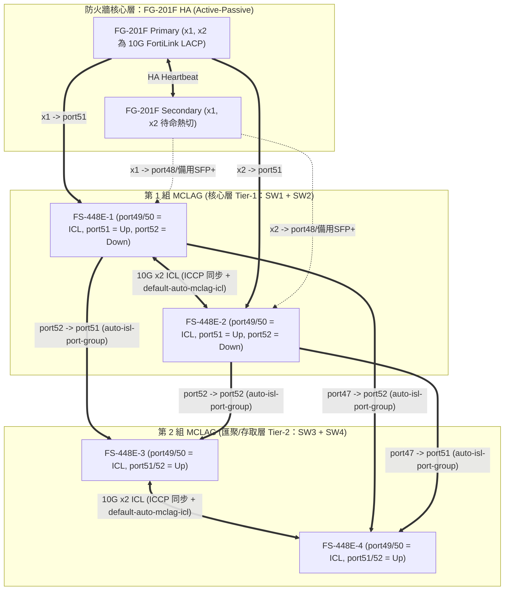

# 🔗 FortiSwitch MCLAG 完整實戰手冊：核心架構、從無到有架設與深度查修（FG-201F HA + 4 台 FS-448E 範例）

> **適用對象**：具備傳統 L2 交換觀念（CCNA：STP / RSTP / 802.3ad LACP / EtherChannel）之資訊人員，欲全面掌握 **FortiSwitch MCLAG（Multi-Chassis Link Aggregation Group）** 運作原理、多層高可用（Two-Tier）建置流程與線上故障排除。

---

## 🧠 一、 核心架構與原理：從 CCNA 思維秒懂 MCLAG

### 1. 為什麼現代企業機房要用 MCLAG？（對照傳統 STP 與 Cisco 堆疊）

在傳統 CCNA 網路設計中，為了避免核心交換器單點故障（SPOF），我們會把兩台核心與兩台存取交換器做全網狀（Full-Mesh）交叉接線，但卻面臨兩難：

| 架構方式 | 運作機制 | 優點 | 致命缺點 / 維運痛點 |
| :--- | :--- | :--- | :--- |
| **傳統 RSTP / MSTP 冗餘** | 靠 Spanning Tree 演算法偵測迴圈，自動將冗餘線路設為 **Blocking** | 跨廠牌通用、設定簡單 | **浪費一半頻寬**（雙 10G 線路永遠只有一條在跑）；斷線切換仍有短暫收斂抖動 |
| **傳統實體堆疊**<br/>（如 Cisco StackWise） | 多台交換器用專用堆疊線合併成「單一大腦（Single Control Plane）」 | 可做跨機 LACP，無 STP Block | **升級韌體時整疊交換器需同時重開機導致全廠斷網**；主控機當機時存在整疊連帶異常風險 |
| **FortiSwitch MCLAG**<br/>（對標 Cisco Nexus vPC） | **雙台獨立控制平面（Dual Control Plane）**，透過 **ICL** 與 **ICCP** 同步 MAC / ARP / LACP 狀態，對外偽裝成同一台交換器 | **1. 所有線路 Active-Active 滿載（無 STP Block）**<br/>**2. 單機斷電 0 秒級切換**<br/>**3. 韌體升級可輪流單台重開，全廠零中斷！** | 建置接線順序有嚴格規範；僅支援 200 系列以上機型（如 `2xx` / `4xx` / `5xx` / `1xxx` / `3xxx`，`1xx` 系列不支援） |

---

### 2. MCLAG 五大核心元件與機制

1. **MCLAG Peer Group（配對群組）**：
   - 每組固定由 **2 台**相同型號、相同韌體版本的 FortiSwitch 組成（例如 2 台 `FS-448E`），兩台互為 **Peer**。
2. **ICL（Inter-Chassis Link，機箱間互聯鏈路）**：
   - 連接兩台 Peer 交換器之間的專屬高速 Trunk（**強烈建議至少用 2 條 10G SFP+ 光纖/DAC 組成 LACP**，避免 ICL 單線斷裂引發腦裂）。
   - 承載兩台之間的同步控制封包與跨機單播/廣播轉發流量。
3. **ICCP（Inter-Chassis Control Protocol，跨機控制協定）**：
   - 跑在 ICL 上的神經系統，負責即時同步兩台交換器的 **MAC Address Table、LACP System ID、STP 狀態與 IGMP 群播表**。
4. **無迴圈轉發鐵律（Split-Horizon 防迴圈規則）**：
   - 封包若從 **ICL** 橫向傳到另一台 Peer，**絕對不會再從該 Peer 的任何 MCLAG 成員埠轉發出去**（除非目標 MCLAG 在對端已斷線），藉此徹底杜絕廣播迴圈，因此跨機雙上行不需靠 STP Block 掉線路！
5. **腦裂防護機制（Split-Brain Protection）**：
   - **情境**：兩台 448E 都還活著有過電，但中間的 **ICL 光纖全斷**（ICCP 心跳失聯），兩台都以為對方死了而搶當主機，會造成 MAC 漂移與重複封包。
   - **FortiSwitch 自動防護**：一旦 ICL 完全斷開，角色為 **Secondary（Dormant）** 的那台交換器會**主動將自己所有的 MCLAG 成員埠關閉（Down / Dormant）**，強制所有流量平滑導向 Primary 單機承載，避免整網癱瘓；待 ICL 修復後自動恢復雙活！

---

### 3. 架構拓樸圖（2x FG-201F HA + 4x FS-448E 雙組 MCLAG）

以下以 **2 台 `FG-201F` (Active-Passive HA) + 4 台 `FS-448E`（兩層 Two-Tier MCLAG）** 為標準範例，展示實體接線與邏輯通道：



*(註：上圖埠號為標準 10G SFP+ 規劃示意；`FS-448E` 具備 4 埠 10G SFP+ `port49`～`port52`，若單台同時需「2 埠做 ICL + 2 埠上接 FG-201F HA + 2 埠下接 Tier-2」超過 4 埠 10G，實務上常見做法是：將 `FG-201F` 的 HA 接線改用 1G/10G 合理分配，或 Tier-1 兩台之間 ICL 用 `port49`～`port50`，剩餘 `port51` 接 FG-201F、`port52` 下接 Tier-2，依現場實際光口數彈性調整，設定語法完全相同。)*

---

## 🛠️ 二、 從無到有架設 SOP（Zero-to-Production 完整步驟）

> [!CAUTION]
> **建置 MCLAG 最高指導原則：嚴禁「一次把所有光纖全部插滿再開機」！**
> 在 MCLAG 與 ICL 尚未配對完成前，兩台交換器彼此不知道對方是同夥；若先插滿交叉迴路，開機瞬間極易引發 **L2 廣播風暴（Broadcast Storm）** 或導致 FortiLink 永遠上不了線。**務必嚴格遵守「逐台納入 → 先立 ICL → 再補交叉冗餘線」的順序！**

### Phase 0：事前硬體與韌體檢查清單
1. **確認型號支援**：4 台皆為 `FS-448E`（支援 MCLAG），且兩兩配對的硬體型號完全一致。
2. **確認韌體版本一致**：4 台 `FS-448E` 必須先升至相同的 FortiSwitchOS 版本（需對照 Fortinet 官方相容性矩陣，確保與 `FG-201F` 的 `FortiOS 7.2.14` 相容）。
3. **建議先還原出廠預設**：若交換器為舊機重拉，先於本機執行 `execute factoryreset` 確保乾淨的 `auto-discovery-fortilink` 環境。
4. **先完成 FortiGate HA**：兩台 `FG-201F` 必須**先組好 Active-Passive HA 並確認同步完成**，再開始納管 FortiSwitch。

---

### Phase 1：設定 FortiGate 的 FortiLink 聚合介面（初期先開啟 Split Interface）

在 MCLAG 還沒建立完成前，FortiGate 的 FortiLink 介面必須**暫時開啟 `fortilink-split-interface enable`**（讓 FortiGate 一次只從一條線探測第一台 Switch，避免還沒組 ICL 就發生 LACP 錯亂）。

在 `FG-201F Primary` CLI 執行：
```bash
config system interface
    edit "fortilink"
        set type aggregate
        set member "x1" "x2"                 # 填入實際接往 Tier-1 交換器的 10G SFP+ 埠
        set fortilink enable
        set fortilink-split-interface enable # 【關鍵】建置初期先 enable，等 Tier-1 ICL 建好再 disable！
        set lacp-mode active
        set ip 169.254.1.1 255.255.255.0
        set allowaccess ping fabric          # 必開 fabric (CAPWAP)
    next
end

# 確認 FortiLink 介面上的 DHCP 與 NTP Server 已開啟（MCLAG 與 Switch 上線極度依賴 NTP！）
config system ntp
    set ntpsync enable
    set server-mode enable
    set interface "fortilink"
end
```

---

### Phase 2：架設第 1 組核心層（Tier-1）MCLAG（SW1 + SW2）

#### 步驟 2-1：單線接入 SW1 並授權上線
1. **只接 1 條線**：將 `FG-201F (x1)` 接到 `SW1 (port51)`。（此時 SW2 先不要插線到 FG-201F！）
2. 到 FortiGate GUI `WiFi & Switch Controller > Managed FortiSwitches`，看到 `SW1` 出現後點擊 **Authorize（授權）**，等待 2～3 分鐘直到顯示 **Online（綠色）**。

#### 步驟 2-2：透過 ICL 接入 SW2 並授權上線
1. **接上 SW1 與 SW2 之間的 2 條 ICL 光纖**（例如 `SW1 port49/50` ↔ `SW2 port49/50`）。*(此時仍先不要把 SW2 接到 FG-201F！)*
2. `SW2` 會透過 `SW1` 的自動 ISL 通道向 `FG-201F` 報到。在 FortiGate 上將 `SW2` **Authorize（授權）**，等待顯示 **Online**。

#### 步驟 2-3：在 FortiGate CLI 宣告 SW1 與 SW2 的 ICL 埠（核心指令！）
> [!IMPORTANT]
> **切勿手動進 Switch 自建 ICL Trunk！** FortiOS 7.x 標準做法是在 FortiGate 上，把兩台互連的埠套用 **`default-auto-mclag-icl`** LLDP Profile，系統就會自動協商建立標準 `_FlInK1_ICL0_` MCLAG 通道。

```bash
# 在 FG-201F CLI 執行（請將序號換成實際 SW1 / SW2 序號）
config switch-controller managed-switch
    edit "S448E_SW1_序號"
        config ports
            edit "port49"
                set lldp-profile "default-auto-mclag-icl"
            next
            edit "port50"
                set lldp-profile "default-auto-mclag-icl"
            next
        end
    next
    edit "S448E_SW2_序號"
        config ports
            edit "port49"
                set lldp-profile "default-auto-mclag-icl"
            next
            edit "port50"
                set lldp-profile "default-auto-mclag-icl"
            next
        end
    next
end
```

#### 步驟 2-4：驗證 Tier-1 ICL 成型，再補接第二條 FortiLink 並關閉 Split Interface
1. 等待約 1～2 分鐘，執行以下指令確認 `SW1` 與 `SW2` 已成功組成 MCLAG Peer Group：
   ```bash
   diagnose switch-controller switch-info mclag icl
   diagnose switch-controller switch-info mclag peer-consistency-check
   ```
   *(確認兩台皆出現在 MCLAG 清單、ICL 狀態為 Up，且 consistency check 無錯誤)*
2. **補插第二條上行線**：將 `FG-201F (x2)` 接到 `SW2 (port51)`（若有 HA 備機 `FG-201F Secondary` 的線也在此時一併接齊至對應埠）。
3. **【最關鍵一步】關閉 `fortilink-split-interface`**，讓兩條 10G FortiLink 正式進入 **Active-Active 滿載模式**：
   ```bash
   config system interface
       edit "fortilink"
           set fortilink-split-interface disable
       next
   end
   ```
4. 觀察 GUI 拓樸圖：`SW1` 與 `SW2` 會被框選成 **MC-LAG Peer Group**，且 `FG-201F` 往下連的兩條線皆為實線（Active）。

---

### Phase 3：架設第 2 組（Tier-2）MCLAG（SW3 + SW4）

若第 2 組 `FS-448E`（`SW3` + `SW4`）是接在第 1 組 `FS-448E` 下方（兩層式 Two-Tier MCLAG），**有一個 90% 工程師都會漏掉的關鍵設定：`auto-isl-port-group`**！

- **為什麼要設 `auto-isl-port-group`？**
  當 `SW1` 和 `SW2` 同時往下各接一條線到下層 `SW3` 和 `SW4` 時，若沒有明確告訴上層 `SW1`/`SW2`「這幾個埠是接往同一組下層 MCLAG 的」，交換器會把它們拆成 2 個各自獨立的 ISL Trunk，導致 STP 瘋狂重算與狀態震盪！

#### 步驟 3-1：逐台接入 SW3 與 SW4 並建立 Tier-2 ICL
1. **先只接 1 條線**：將 `SW1` 的下行埠接到 `SW3` 的上行埠。等待 `SW3` 在 FortiGate 出現並 **Authorize** 上線。
2. **接上 SW3 與 SW4 的 2 條 ICL 線**（如 `port49/50`）。等待 `SW4` 透過 `SW3` 出現並 **Authorize** 上線。
3. **在 FortiGate CLI 設定 SW3 與 SW4 的 ICL Profile**（同步驟 2-3）：
   ```bash
   config switch-controller managed-switch
       edit "S448E_SW3_序號"
           config ports
               edit "port49"
                   set lldp-profile "default-auto-mclag-icl"
               next
               edit "port50"
                   set lldp-profile "default-auto-mclag-icl"
               next
           end
       next
       edit "S448E_SW4_序號"
           config ports
               edit "port49"
                   set lldp-profile "default-auto-mclag-icl"
               next
               edit "port50"
                   set lldp-profile "default-auto-mclag-icl"
               next
           end
       next
   end
   ```
4. 確認 `SW3` 與 `SW4` 已成功組成第 2 組 MCLAG（用 `diagnose switch-controller switch-info mclag list` 確認看到兩組 Peer Group）。

#### 步驟 3-2：在 Tier-1（SW1 & SW2）設定 `auto-isl-port-group`
此設定需在 **上層交換器（`SW1` 與 `SW2`）本機 CLI** 執行（兩台輸入的群組名稱必須一模一樣，成員埠填入各台往下接 `SW3`/`SW4` 的埠號）：

```bash
# 透過 FG-201F SSH 連入 SW1 本機 CLI（或從 GUI 開啟 Open CLI），接著在 SW2 執行相同設定：
config switch auto-isl-port-group
    edit "Tier2-MCLAG-Group"
        set members "port47" "port52"   # 填入 SW1 (與 SW2) 往下接往 SW3、SW4 的下行埠
    next
end
```
*(小技巧：亦可在 FortiGate 下 `config switch-controller custom-command` 寫成範本推送至 `SW1`、`SW2`，日後換機也不會遺失設定！)*

#### 步驟 3-3：補齊 Tier-1 ↔ Tier-2 交叉冗餘光纖
1. 此時才將剩餘的交叉光纖（`SW1` ↔ `SW4`、`SW2` ↔ `SW3`、`SW2` ↔ `SW4`）全部插上。
2. 等待 1～2 分鐘讓 LACP 自動收斂，立刻跑 `diagnose switch-controller switch-info mclag peer-consistency-check` 確認 4 台全部 `OK`！

---

### Phase 4：實戰延伸 — 將雙網卡伺服器（ESXi / SimpliVity / NAS）跨機雙接進 MCLAG

若機房內有虛擬化主機（如 VMware ESXi / HPE SimpliVity / 核心檔案伺服器）拉了 2 條線，一條插 `SW1 port15`、一條插 `SW2 port15`，想跑跨交換器 802.3ad LACP（頻寬加倍 + 單台交換器壞掉不斷線）：

**在 `FG-201F` CLI 建立跨機 MCLAG Trunk（重點：兩台 Switch 上的 Trunk 名稱必須完全一致，且都要 `set mclag enable`！）**：
```bash
config switch-controller managed-switch
    edit "S448E_SW1_序號"
        config ports
            edit "MCLAG_ESXi01"             # 【關鍵】兩台 Switch 上的 Trunk 名稱必須一模一樣！
                set type trunk
                set mode lacp-active        # 伺服器端網卡亦須設為 802.3ad LACP
                set mclag enable            # 【關鍵】啟用跨機 MCLAG 屬性
                set members "port15"
                set vlan "VLAN_Server"
                set allowed-vlans "VLAN_vMotion" "VLAN_VM_Net"
            next
        end
    next
    edit "S448E_SW2_序號"
        config ports
            edit "MCLAG_ESXi01"             # 與 SW1 同名！
                set type trunk
                set mode lacp-active
                set mclag enable
                set members "port15"
                set vlan "VLAN_Server"
                set allowed-vlans "VLAN_vMotion" "VLAN_VM_Net"
            next
        end
    next
end
```
*(若習慣用 GUI 操作：在 `WiFi & Switch Controller > FortiSwitch Ports` 中，先在 SW1 選 `port15` 點 **Create Trunk** 勾選 **MCLAG**；再到 SW2 選 `port15` 建立**完全同名**的 Trunk 並勾選 **MCLAG** 即可。)*

---

## 🔍 三、 MCLAG 系統化查修指令集與判讀標準

### 1. 在 FortiGate（`FG-201F`）上集中檢查全網 MCLAG（日常巡檢首選）

```bash
# 1. 總覽 4 台 448E 連線狀態（確認全部為 Authorized / Up）
execute switch-controller get-conn-status

# 2. 列出所有 MCLAG Trunk 群組與配對狀態
diagnose switch-controller switch-info mclag list

# 3. 檢查每組 MCLAG 之間的 ICL 命脈通道狀態（確認 peer-ip、state、ICCP 連線正常）
diagnose switch-controller switch-info mclag icl

# 4. 【最高權威健檢】一鍵檢查所有 MCLAG Peer 之間的 VLAN、Trunk、STP 與參數一致性！
diagnose switch-controller switch-info mclag peer-consistency-check

# 5. 檢查各台 448E 的 Trunk 聚合埠狀態（確認每條成員線都是 up / active，而非 down / standby）
diagnose switch-controller switch-info trunk status

# 6. 檢查 STP 狀態（確認跨機 MCLAG 皆為 Forwarding，沒有意外被 Block 的骨幹線路）
diagnose switch-controller switch-info stp
```

### 2. 跳板進入單台 FortiSwitch（`FS-448E`）本機深挖底層

```bash
# 從 FG-201F SSH 跳板進入指定 448E（IP 可由 get-conn-status 查得）
execute ssh admin@169.254.1.x

# ====== 以下於 FS-448E 本機 CLI 執行 ======

# 1. 查看本機 MCLAG 詳細狀態（重點看 Local / Peer 角色、Keepalive 是否正常）
diagnose switch mclag list
diagnose switch mclag icl
diagnose switch mclag peer-consistency-check

# 2. 查看本機 LACP Trunk 協商細節（查對端伺服器或交換器有沒有送 LACPDU 過來！）
diagnose switch trunk list
diagnose switch trunk summary

# 3. 查看本機 STP 實例、Root Bridge 與各埠狀態（排查是否發生 TCN 拓樸震盪！）
diagnose stp instance list

# 4. 【查實體光纖必用】檢查 448E 背後 10G SFP+ 模組光衰與溫度（排查 ICL 偶發斷線）
get switch modules status
get switch modules detail port49

# 5. 檢查是否套用了正確的 auto-isl-port-group（Tier-1 專用）
show switch auto-isl-port-group
```

### 3. 查修輸出關鍵字秒判表

| 指令與欄位 | 正常健康狀態 | 異常警訊與立即對應意義 |
| :--- | :--- | :--- |
| `mclag icl` → **ICL Status / State** | `Up` / `Established`（ICCP 雙向計數持續增加） | `Down` / `Init` 👉 ICL 光纖斷裂、SFP+ 故障、或 LLDP Profile 未設妥 |
| `mclag peer-consistency-check` | 全項目皆為 **`OK`** 或無錯誤輸出 | 出現 **`MISMATCH`** 👉 兩台 Peer 的 Trunk 名稱、VLAN 清單、STP 或 LACP 模式未對齊，或有人手動改了 ICL |
| `mclag list` → **Role / State** | 一台 `Primary (Active)`、一台 `Secondary (Active)` | 出現 **`Dormant`**（休眠）👉 **觸發了腦裂防護！** ICL 斷線導致 Secondary 主動關閉 MCLAG 埠 |
| `trunk status` → **LACP 成員埠** | 所有實體成員埠皆顯示 **`up`** 且 flag 為 **`active`** | 出現 `standby` / `down` 👉 對端沒開 LACP（誤設成 static）、或 `fortilink-split-interface` 忘了關 |
| `stp instance list` → **Role / State** | 骨幹線路皆為 **`Forwarding`**，TCN 次數靜止不跳動 | 出現 `Discarding` 或 TCN 次數每秒狂跳 👉 多層 MCLAG 漏設 `auto-isl-port-group`，或現場有人誤插桌邊小 Hub 造成迴圈 |

---

## 🚨 四、 MCLAG 實務 5 大經典踩坑與故障排除 SOP

### 踩坑 1：FortiLink 兩條 10G 線只有一條在跑，另一條永遠不亮 / Standby
- **原因**：建置時開啟了 `fortilink-split-interface enable`，建立完 MCLAG 後忘記改回 `disable`。
- **解法**：在 `FG-201F` 上執行 `show system interface fortilink` 確認；若看到 `set fortilink-split-interface enable`，請在確認 `mclag icl` 為 Up 後改為 `disable`。

### 踩坑 2：`peer-consistency-check` 出現 `MISMATCH`，且網路偶發全段重置
- **原因**：Fortinet 官方明確列出的經典雷區——工程師把系統自動產生的 `_FlInK1_ICL0_` 刪掉，改用「手動建立 Trunk」的方式串接 ICL；或是對端伺服器的 MCLAG Trunk 在兩台 Switch 上設了不同的允許 VLAN（`allowed-vlans`）。
- **解法**：
  1. 若是伺服器 MCLAG 不一致：對齊兩台 Switch 上該 Trunk 的 `vlan`、`allowed-vlans` 與 `mode`。
  2. 若是 ICL 被手動自建：刪除手動建立的 ICL Trunk，確認 ICL 兩端埠皆套用 `lldp-profile default-auto-mclag-icl`，重啟其中一台 Peer 讓系統自動重建標準 ICL。

### 踩坑 3：接上第 2 組（Tier-2）448E 的交叉光纖後，全公司網路頓卡、STP 日誌暴增
- **原因**：Tier-1（`SW1` / `SW2`）未設定 `config switch auto-isl-port-group`，導致兩台 Tier-1 沒有把往下接 Tier-2 的線視為同一個 MCLAG 聚合群組。
- **解法**：依本文 Phase 3-2 在 `SW1`、`SW2` 補建相同名稱的 `auto-isl-port-group`，並將該組下行埠執行一次 `down` 再 `up`（重新觸發 ISL 協商），STP 震盪即刻平息。

### 踩坑 4：其中一台 448E 的 MCLAG 成員埠全部熄燈（狀態顯示 `Dormant`）
- **原因**：**ICL 全部斷線**觸發了 Split-Brain 腦裂保護機制！
- **解法**：
  1. 立刻檢查兩台 448E 之間的 ICL 實體光纖與 SFP+ 模組（跑 `get switch modules status` 查光衰）。
  2. 修復 ICL 實體連線後，ICCP 會自動重新握手，Secondary 交換器的 `Dormant` 埠會自動解除鎖定並恢復雙活轉發（**切勿在 ICL 還沒修好前盲目重開 Primary 交換器，否則會造成短暫全斷！**）。

### 踩坑 5：MCLAG 架構下如何「不斷網升級韌體」與「單機故障 RMA 換機」？
1. **不斷網升級韌體（Hitless Upgrade）**：
   - 確認 `diagnose switch-controller switch-info mclag peer-consistency-check` 全為 `OK`。
   - **千萬不要勾選「同時升級全部 4 台」**！
   - 依序 **一台一台升級並重開**：先升 `SW2`（等回線且 ICL 恢復 Up）→ 再升 `SW1` → 再升 `SW4` → 最後升 `SW3`。只要伺服器與下層交換器都有雙線跨機接入，整個升級過程終端完全不斷網！
2. **單台 448E 故障更換新機（RMA Replacement）**：
   - 先將備品 `FS-448E` 獨立通電升級至與線上存活 Peer **完全相同的 FortiSwitchOS 版本**並還原出廠預設。
   - **拔除故障機**，在 FortiGate CLI 備份舊設定，並將新機先以 **單條 ICL 線**接上存活的 Peer（先別插滿所有交叉線）。
   - 於 FortiGate 使用替換/授權流程將舊機設定套用至新機序號（或在 `Managed FortiSwitches` 授權後套用相同 `default-auto-mclag-icl` 與 Port 設定）。
   - 確認新機與存活 Peer 的 `mclag icl` 與 `peer-consistency-check` 皆為 `OK` 後，再將剩餘的上行、下行與伺服器雙網卡線全部插回！
