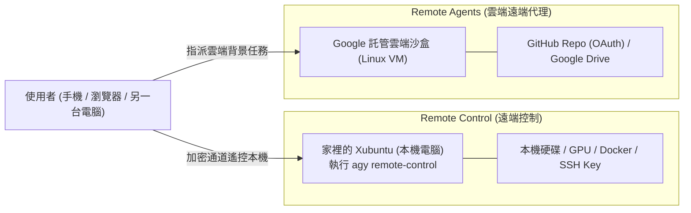

# 🐧 Xubuntu 安裝與遷移 Antigravity CLI (`agy`) 完整筆記

> 本文檔已歸檔於知識庫 `topics/xubuntu-agy-installation-guide.md`，並永久同步於本地與雲端。

這份筆記整理了在 **Xubuntu** 上將 `agy` 從 **Snap 版本**更換為 **官方獨立安裝版（Standalone Binary）** 的完整流程，以及 **Remote Control vs. Remote Agents** 完整比較、日常維護與常見問題排解。

---

## 一、 Snap 版 vs. 官方獨立安裝版：詳細優缺點分析

### 1. 總覽對照表

| 比較維度 | Snap 版 (`/snap/antigravity-cli/...`) | 官方獨立安裝版 (`~/.local/bin/agy`) |
| :--- | :--- | :--- |
| **執行環境** | 運行於 Snap 嚴格沙盒（Strict Confinement）與獨立 Mount Namespace 中 | 原生運行於你的個人使用者（User）環境中 |
| **自動背景更新** | **支援**（由系統 `snapd` 服務在背景自動檢查並更新） | **不支援自動背景更新**（需執行 `agy update` 觸發） |
| **遠端在對話中更新** | **不可行**（沙盒禁止呼叫 `sudo`，且 `/snap` 為唯讀 SquashFS） | **完全支援**（在遠端對話中直接叫 Agent 執行 `agy update` 免密碼更新） |
| **Agent 執行系統指令** | **受限**（無法使用 `sudo`、部分系統路徑與特殊硬體/Socket 被隔離） | **完全不受限**（你在終端機能跑的指令、Docker、系統管理，Agent 都能幫忙跑） |
| **啟動速度與資源** | 首次啟動略慢，且佔用一個 Loop 掛載點（`/dev/loopX`） | 原生單一執行檔，啟動最快、零額外掛載開銷 |
| **設定與資料路徑** | `~/snap/antigravity-cli/common/.gemini/antigravity-cli` | `~/.gemini/antigravity-cli`（官方標準路徑） |

---

### 2. Snap 版的優缺點

- **優點**：
  1. **系統級背景自動更新（免動手）**：Ubuntu / Xubuntu 的 `snapd` 預設每天會在背景自動更新套件，不需手動執行更新指令。
  2. **版本回退（Rollback）容易**：若新版異常，Snap 會保留前一版映像檔，在主機執行 `sudo snap revert antigravity-cli` 即可一秒退回舊版。
  3. **高安全性隔離（沙盒保護）**：受 AppArmor 與 Seccomp 沙盒保護，即使開啟自動允許權限，Agent 也無法透過 `sudo` 修改系統核心設定或存取未授權的系統目錄。
- **缺點**：
  1. **無法在 Antigravity 遠端對話中觸發更新**：`/snap` 為唯讀檔案系統，且沙盒內呼叫 `/usr/bin/sudo` 會直接被拒絕（`Permission denied`），必須另開 SSH 或回到電腦前才能手動更新。
  2. **Agent 協助系統維護與開發時容易受限**：當請 Agent 安裝系統套件（`sudo apt install ...`）、重啟系統服務（`systemctl`）或操作受保護的開發環境時，會頻繁撞到 Snap 沙盒限制。
  3. **設定檔路徑非標準**：資料路徑被重導向至 `~/snap/antigravity-cli/common/` 下，若要寫腳本或跨電腦同步 `~/.gemini/antigravity-cli`（如 Skills、Rules、MCP 設定），路徑與其他電腦不一致。

---

### 3. 官方獨立安裝版（`~/.local/bin/agy`）的優缺點

- **優點**：
  1. **完美的遠端自我更新（`agy update`）**：執行檔位於個人家目錄 `~/.local/bin/agy`，擁有完整寫入權限。隨時可在遠端對話中請 Agent 執行 `agy update` 直接完成更新，無須 `sudo` 密碼。
  2. **完整的開發與系統控制能力**：無 Snap 沙盒阻擋，Agent 的終端機環境與原生 Terminal 完全一致，整合各種 CLI 工具、MCP Server、本地服務或系統腳本最順暢。
  3. **標準化的設定檔路徑（`~/.gemini/antigravity-cli`）**：所有 Skills、Rules、Plugins 和 `settings.json` 皆位於官方標準路徑，方便對照官方文件或使用 Git 跨機同步。
  4. **輕量、啟動快**：單一 Binary 直接執行，無 SquashFS 掛載開銷。
- **缺點**：
  1. **不會在背景自動更新**：除非自行設定 Cron Job，否則需手動或請 Agent 執行 `agy update` 升級。
  2. **權限較大，需注意安全**：無 Snap 沙盒硬性隔離，Agent 擁有當前登入帳號的完整權限。

> [!TIP]
> **總結建議**：如果你經常**遠端連線**使用這台 Xubuntu、希望能隨時從遠端更新 `agy`，或是會請 Antigravity 幫你設定開發環境、管理 Git / GitHub、配置自訂 Skills 與 MCP，強烈建議更換為 **官方獨立安裝版**。

### 4. 換成原生安裝版後，實際「多做到」哪些事？
1. **遠端對話中一鍵自我更新**：不用開 SSH、不用輸入 `sudo`，隨時請 Agent 執行 `agy update` 即可升級。
2. **完整呼叫系統工具與開發服務**：不再遇到 `/usr/bin/sudo: Permission denied`，也能順利操作 `apt`、`systemctl`、`Docker`（`/var/run/docker.sock`）或讀寫 `/mnt`、`/media`、`/opt` 等非家目錄路徑。
3. **無縫沿用本機開發環境與憑證**：直接使用真正的 `$HOME`，自動讀取你原本的 `~/.ssh` 金鑰、`~/.gitconfig`、`gh` CLI 登入狀態，以及 `pyenv`、`conda`、`nvm` 等環境，推上 GitHub 不再卡關。
4. **標準路徑跨機同步**：`~/.gemini/antigravity-cli` 與官方文件及其他作業系統一致，方便用 Git 同步自訂 Skills、Rules 與 MCP 設定。

---

## 二、 Remote Control vs. Remote Agents 完整比較

在 Google Antigravity 中，這兩個功能都能讓你從手機或瀏覽器遠端使用 Agent，但核心差異在於**「程式碼與 Agent 究竟跑在哪裡」**。



### 1. 詳細對照表

| 比較項目 | Remote Control（遠端控制） | Remote Agents（雲端遠端代理） |
| :--- | :--- | :--- |
| **運算與執行位置** | **你的本機電腦**（如家裡的 Xubuntu） | **Google 託管的雲端沙盒**（獨立 Linux 虛擬機） |
| **電腦是否需開機** | **必須開機且連網**（並啟動 `agy remote-control`） | **不需要**（關瀏覽器或電腦休眠，雲端仍會繼續跑完） |
| **檔案與程式碼來源** | 直接讀寫**本機硬碟**的檔案、尚未 commit 的程式、本地資料庫 | 透過 OAuth 綁定 **GitHub Repository**、Google Drive 或直接上傳檔案 |
| **開發環境與工具** | 使用**本機環境**（本地 GPU、Docker、外接硬碟、本地 Skills/MCP） | 使用 **Google 預設雲端 Linux 環境**（預裝 Python、Node.js 等，無法碰本機硬體） |
| **交付成果方式** | 直接修改你本機硬碟上的檔案 | 在雲端修改並跑完測試後，直接 **Commit、Push 並開 Pull Request (PR)** 回 GitHub |
| **帳號與方案限制** | 一般 Antigravity 桌面版與 CLI (`agy`) 皆可使用 | 需為個人帳號的 **Google AI Pro / Google AI Ultra** 訂閱方案 |

### 2. 什麼時候該用哪一個？（搭配策略）
- **使用 Remote Control 的時機**：
  - 處理**還沒推上 GitHub 的本機專案**或大型資料檔。
  - 需要用到家裡 Xubuntu 的**硬體資源**（GPU、Docker、本機服務）或遠端維護這台電腦。
  - 想從同一介面管理多台自己的實體電腦。
- **使用 Remote Agents 的時機**：
  - **家裡電腦沒開機**，但在外面突然想修一個 GitHub 上的 Bug 或加新功能。
  - 需要同時派出多個背景任務各自處理不同的 GitHub Issue，跑完後直接發 PR 讓你 Review。
  - 想在完全乾淨隔離的雲端環境測試程式，不想弄亂本機系統。

---

## 三、 完整遷移與安裝步驟（回家後在 Xubuntu 終端機執行）

### 步驟 1：停止目前執行中的遠端服務並遷移設定檔
Snap 版本將你的登入憑證、設定檔（`settings.json`）、自訂 Skills 與對話紀錄存放在 `~/snap/antigravity-cli/common/.gemini/antigravity-cli`。在移除 Snap 前，先將它們複製到標準路徑 `~/.gemini/antigravity-cli`，即可免去重新設定與重新登入的麻煩：

```bash
# 1. 若有執行中的 remote-control 背景服務，先將其停止
agy remote-control stop 2>/dev/null || true

# 2. 建立標準設定目錄並將現有設定與紀錄完整複製過去
mkdir -p ~/.gemini
cp -a ~/snap/antigravity-cli/common/.gemini/antigravity-cli ~/.gemini/
```

---

### 步驟 2：移除 Snap 版的 `agy`
確認設定檔已備份到 `~/.gemini/antigravity-cli` 後，即可移除 Snap 套件：

```bash
sudo snap remove antigravity-cli
```

---

### 步驟 3：使用官方腳本安裝獨立版 `agy`
執行 Google Antigravity 官方的一鍵安裝腳本：

```bash
curl -fsSL https://antigravity.google/cli/install.sh | bash
```

這個腳本會自動完成以下動作：
1. 偵測你的 Linux 系統架構（如 `x86_64`）。
2. 下載最新穩定版 `agy` 執行檔並安裝至 `~/.local/bin/agy`。
3. 自動檢查並將 `~/.local/bin` 加入你的 `~/.bashrc` 環境變數 `PATH` 中。

---

### 步驟 4：重新載入環境並驗證安裝
安裝完成後，重新載入 Shell 設定並確認路徑與版本：

```bash
# 重新載入 bashrc（並清除 bash 對舊路徑的快取）
source ~/.bashrc
hash -r

# 確認執行檔路徑是否已變更為 ~/.local/bin/agy
which agy

# 確認版本號
agy --version
```

> [!NOTE]
> 如果執行 `which agy` 沒有顯示 `~/.local/bin/agy`，可以使用 `agy install` 指令讓 CLI 自動幫你配置好環境變數與路徑，或手動在 `~/.bashrc` 最後加上一行：
> ```bash
> export PATH="$HOME/.local/bin:$PATH"
> ```

---

## 四、 日常維護、遠端連線與更新指令速查

完成遷移後，未來在 Xubuntu 上的常用操作如下：

### 1. 自我更新（本地或遠端皆可）
在終端機直接輸入，或在 Antigravity 對話中請 Agent 幫你執行：
```bash
agy update
```
- `agy` 會直接下載新版執行檔並覆蓋 `~/.local/bin/agy`，**不需要 `sudo` 密碼**。
- 更新完成後，新開的對話或重啟 `remote-control` 後即會套用最新版本。

### 2. 遠端控制服務（Remote Control）管理
如果你習慣在出門前讓家裡的 Xubuntu 保持遠端連線待命：
```bash
# 啟動背景遠端連線 daemon
agy remote-control start

# 查看目前遠端連線服務的狀態
agy remote-control status

# 停止遠端連線服務
agy remote-control stop

# 若想直接啟動互動式 CLI 並同時開啟遠端控制
agy --remote-control
```

> [!IMPORTANT]
> **遠端更新後如何讓背景服務套用新版？**
> 當你在遠端請 Agent 執行 `agy update` 更新完執行檔後，若要讓背景的 `remote-control` 服務也切換到新版本，只需執行：
> ```bash
> agy remote-control stop && agy remote-control start
> ```
> （若在遠端對話中讓 Agent 執行重啟，連線會短暫重連一次，重連後即為最新版本。）

### 3. 進階實用技巧：讓 Xubuntu 保持穩定待命
- **防止電腦自動休眠斷線**：如果出門時希望隨時能連回家裡的 Xubuntu，記得在 Xubuntu 的「電源管理員（Power Manager）」中將「系統休眠（System sleep）」設為永不，以免電腦進入休眠導致 `remote-control` 斷線。
- **開機自動啟動 `remote-control`（選用）**：若希望電腦重開機後自動恢復遠端連線待命，可以在 Xubuntu 的「工作階段與啟動（Session and Startup）」→「應用程式自動啟動」新增一筆指令：
  ```bash
  /home/<你的使用者名稱>/.local/bin/agy remote-control start
  ```

---

## 五、 常見問題排解（Troubleshooting）

| 問題狀況 | 可能原因 | 解決方式 |
| :--- | :--- | :--- |
| 移除 Snap 後輸入 `agy` 顯示 `No such file or directory` | Bash 仍快取了舊的 `/snap/bin/agy` 路徑 | 執行 `hash -r && source ~/.bashrc`，或直接重開終端機視窗 |
| `which agy` 找不到指令 | `~/.local/bin` 尚未加入 `PATH` | 執行 `~/.local/bin/agy install` 或在 `~/.bashrc` 加入 `export PATH="$HOME/.local/bin:$PATH"` |
| 遷移後需要重新登入或找不到舊紀錄 | 忘記先複製 Snap 的設定目錄 | 若尚未刪除 Snap 備份，檢查 `~/snap/antigravity-cli/common/.gemini/antigravity-cli` 並複製至 `~/.gemini/` |
| 在遠端無法連上這台 Xubuntu | `remote-control` 未啟動或電腦休眠 | 回到電腦執行 `agy remote-control status` 檢查狀態，必要時執行 `agy remote-control start` |

---

## 六、 重要檔案與目錄位置參考

安裝完成後，所有相關檔案都會集中於你的個人家目錄下，方便管理與備份：

- **執行檔位置**：`~/.local/bin/agy`
- **全域設定檔**：`~/.gemini/antigravity-cli/settings.json`
- **自訂 Skills 目錄**：`~/.gemini/antigravity-cli/skills/`（未來可在此建立 `update-to-github` 等自訂 Skill）
- **自訂 Rules / 對話紀錄**：`~/.gemini/antigravity-cli/`
- **預設暫存專案目錄（Scratch）**：`~/.gemini/antigravity-cli/scratch/`
